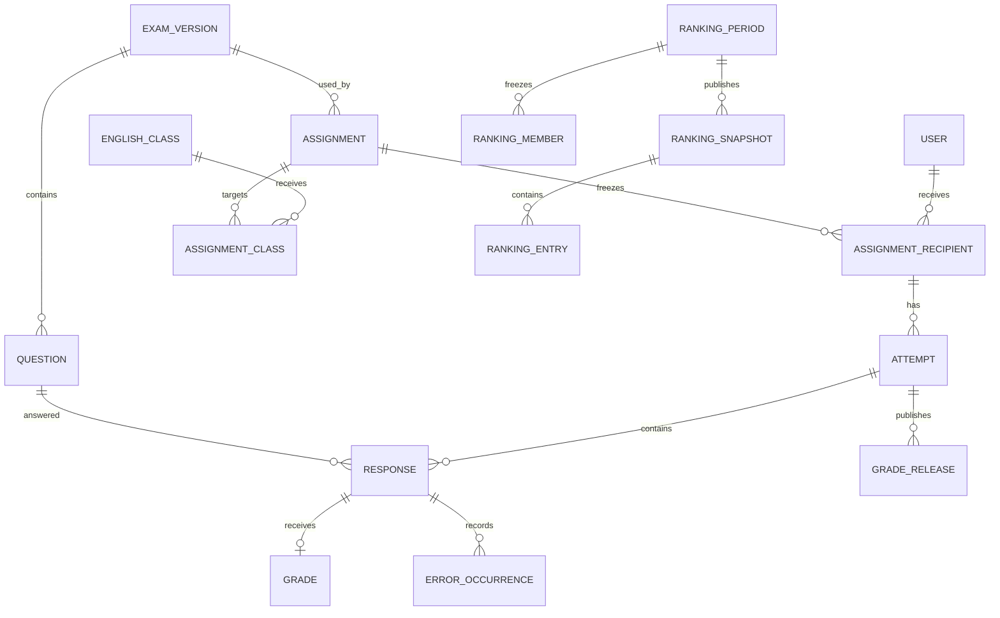

# Mô hình dữ liệu và giao dịch

Django models + migrations là nguồn thực thi. Tên bảng dưới là tên logic, app label được phép thêm prefix. Không tự gộp bảng làm mất lịch sử. Mọi dữ liệu thuộc một bản cài đặt của một OWNER; chưa có multi-tenant.

## Quy ước

PK UUID, trừ bảng nội bộ Django/thư viện. FK cùng kiểu với PK đích. `?` là nullable; trường còn lại NOT NULL. Text mặc định chuỗi rỗng chỉ khi ghi rõ. Timestamp dùng timestamptz UTC. Decimal điểm dùng numeric(8,2), phần trăm numeric(5,2); không float. Trường status/kind/skill/difficulty dùng text choice + DB CHECK. Các bảng có created_at; bảng sửa được có updated_at. Các trường snapshot tên/nhãn là text, không dùng FK thay cho lịch sử hiển thị. Tên học sinh có thể trùng.

Bảng lịch sử, release, snapshot và đề PUBLISHED không được cập nhật/xóa qua API thường. FK dữ liệu đã nộp dùng RESTRICT/PROTECT. Chỉ CASCADE các bảng con thuộc DRAFT chưa được dùng, và xóa trong workflow rõ ràng. Quy trình xóa riêng tư riêng ở tài liệu 05, không dựa vào cascade từ user. Thao tác xuyên bảng phải qua service transaction, không cho Django admin bỏ qua invariant.

## Danh tính và tổ chức

| Bảng | Trường và ràng buộc |
|---|---|
| User | id, role OWNER/STUDENT, display_name varchar(120), username unique cho Django auth, password do Django quản lý, status ACTIVE/SUSPENDED/ARCHIVED, auth_epoch int default 0, archived_at?. STUDENT dùng unusable password, username nội bộ không công khai. Partial unique OWNER bảo đảm tối đa một chủ. |
| StudentProfile | user_id PK/FK User, student_ref varchar(32) unique, owner_note text default ''. Không tự thêm email, ngày sinh, điện thoại. |
| School | id, code varchar(32) unique, name varchar(160), archived_at?. |
| SchoolClass | id, school_id, school_year varchar(9) dạng YYYY-YYYY+1, grade smallint 1..12, name varchar(40), archived_at?. Unique(school_id,school_year,grade,name). |
| SchoolMembership | id, student_id, school_class_id, start_at, end_at?. end>start; PostgreSQL exclusion(student_id WITH =, tstzrange(start,end,'[)') WITH &&) dùng btree_gist ngăn chồng thời gian. |
| EnglishClass | id, code varchar(10) unique dạng ENG-XXXXXX, name varchar(120), school_year varchar(9), archived_at?. |
| EnglishMembership | id, student_id, class_id, start_at,end_at?. Exclusion theo student_id,class_id và range; cho phép nhiều lớp khác nhau. |
| AccessCode | id, student_id, code_digest char(64) unique, key_version smallint, issued_at, revoked_at?. Partial unique student_id WHERE revoked_at IS NULL. Không lưu mã thô. |
| LoginBucket | bucket_key char(64), window_start timestamp, count int>=0; PK(bucket_key,window_start). Khóa bao gồm kind và chiều rate limit, không chứa mã/IP thô. |
| AuditEvent | id, actor_id? (system null), action varchar(80), target_type,target_id?, reason text default '', metadata jsonb đã lọc, request_id uuid, created_at. Append-only, không response/request body mặc định. |

Dùng bảng session, TOTP device và backup token của Django/thư viện; không tự khai báo lại. Secret TOTP cần quyền database riêng, encryption at rest và backup được mã hóa. Thay khóa HMAC mã phải có key_version và quy trình cấp lại toàn bộ mã trước khi bỏ khóa cũ. Thay khóa app/session làm mất phiên phải được thông báo cho vận hành.

## Nội dung đề và tệp

| Bảng | Trường và ràng buộc |
|---|---|
| Exam | id,title varchar(200),created_by FK OWNER,archived_at?. |
| ExamVersion | id,exam_id,number int>0,status DRAFT/PUBLISHED/ARCHIVED,published_at?,revision int>=0; unique(exam_id,number). |
| Asset | id,uploaded_by, purpose PROMPT_AUDIO/RESPONSE_AUDIO, object_key unique, original_name varchar(255) default empty, detected_mime varchar(80)?, bytes bigint>0?,duration_ms int>0?, sha256 char(64)?, status UPLOADING/READY/REJECTED/DELETING/DELETED, expires_at? cho tệp chưa gắn. READY bắt buộc bytes, detected_mime, duration_ms, sha256 đã xác minh. UPLOADING cho phép null. Response được trỏ UPLOADING chỉ qua init upload của server. |
| Passage | id,version_id,ref varchar(40),text_body text default '',audio_asset_id?, transcript text default ''; unique(version_id,ref); có text hoặc audio. Transcript chỉ được gửi lúc answers release; không đưa vào student payload đang làm. |
| Question | id,version_id,position int 1..100,type,skill,difficulty FOUNDATION/STANDARD/CHALLENGE,prompt text,max_points numeric(8,2)>0<=100,passage_id?,explanation text default ''; unique(version_id,position). Passage phải cùng version. Ma trận type/skill theo BR-03, enforce DB CHECK. |
| QuestionOption | id,question_id,key varchar(1) A..F,position smallint,content text; unique(question_id,key),unique(question_id,position). |
| AnswerKeyOption | question_id,option_id; composite PK, option phải thuộc question (composite FK hoặc constraint trigger). Số đáp án được kiểm tra trong transaction publish. Không đặt is_correct trong payload options dùng chung. |
| RubricCriterion | id,question_id,key varchar(40),position 1..4,label varchar(120),level_descriptions jsonb có đúng keys '0'..'4'; unique(question_id,key/position). Chỉ TEXT/AUDIO, đủ 4 khi publish. Version kế thừa từ Question, không cần rubric version độc lập. |
| Tag | id,kind TOPIC/ERROR,skill,name varchar(100),archived_at?; unique(kind,skill,name). Không sửa tên/skill tag đã dùng; tạo tag mới, có thể archive. |
| QuestionTag | question_id,tag_id; composite PK; skill phải trùng; publish cần >=1 TOPIC. |

Asset không bị xóa khi còn đề PUBLISHED, response hoặc release tham chiếu. Đường dẫn object không được trả cho học sinh; trả URL proxy có kiểm tra quyền. Tệp REJECTED không được gắn mới vào câu trả lời/đề; pending asset đã gắn qua init được giữ pointer khi trở thành REJECTED để chặn submit đến khi học sinh gỡ hoặc init lại. DELETING/DELETED không thể gắn mới. Tài nguyên dùng lại không đồng nghĩa học sinh có quyền xem qua mọi bài: endpoint phải có ngữ cảnh assignment/response.

## Bài giao và lần làm

| Bảng | Trường và ràng buộc |
|---|---|
| Assignment | id,version_id,title varchar(200),code unique HW-XXXXXX,status DRAFT/PUBLISHED/CANCELLED,opens_at,due_at,late_until,late_policy,revision int>=0,published_at?,answers_released_at?,cancel_reason text default ''. Check thời gian theo BR-04. |
| AssignmentClass | assignment_id,class_id; PK kép. Chỉ định lớp nguồn, không là nguồn quyền sau publish. |
| AssignmentRecipient | id,assignment_id,student_id,state ASSIGNED/EXEMPT,assigned_at,exempt_reason text default '',school_class_id?,school_id?,grade?,school_year?,school_name_snapshot?,school_class_name_snapshot?,current_attempt_id?. Unique(assignment_id,student_id). current_attempt phải thuộc chính recipient. |
| RecipientEnglishClass | recipient_id,class_id,class_name_snapshot,school_year_snapshot; PK(recipient_id,class_id). Không đọc membership hiện tại để tính phạm vi quá khứ. |
| Attempt | id,recipient_id,attempt_no int 1..5,status IN_PROGRESS/SUBMITTED/GRADED/VOID,revision int>=0,started_at,submitted_at?,due_at_at_submit?,is_late bool default false,graded_at?,void_reason text default '',replacement_reason text default ''; unique(recipient_id,attempt_no),partial unique recipient_id WHERE status='IN_PROGRESS'. |
| Response | id,attempt_id,question_id,text_answer text default '',audio_asset_id?,revision int>=0; unique(attempt_id,question_id). Tạo sẵn một response/câu khi start. Câu phải thuộc version assignment. |
| ResponseOption | response_id,option_id; PK kép; option thuộc question của response. SINGLE tối đa một option, kiểm tra service; composite FK/trigger ngăn option từ câu khác. |
| SubmissionRequest | attempt_id,idempotency_key uuid,payload_digest char(64),result jsonb,created_at; PK(attempt_id,idempotency_key). Không lưu text/audio trong result. |

FK vòng AssignmentRecipient.current_attempt_id tạo nullable trước, migration thêm FK sau. Service bắt buộc verify recipient của current_attempt. Check constraints/trigger deferred nếu cần, và test trực tiếp giao dịch. Phiên bản đề không thuộc payload student có thể sửa.

## Chấm và lỗi

| Bảng | Trường và ràng buộc |
|---|---|
| Grade | id,response_id unique,source AUTO/TEACHER,points numeric(8,2),feedback text default '',revision int>=0,graded_by?,graded_at. Chưa chấm thì chưa có Grade, không tạo điểm null/0 mặc định. 0<=points<=Question.max_points kiểm tra transaction/trigger. |
| CriterionScore | grade_id,criterion_id,level smallint 0..4,note text default ''; PK kép. Criterion thuộc question của response, đủ 4 cho chấm tay. |
| GradeHistory | id,grade_id,revision,previous jsonb,next jsonb,actor_id?,reason,created_at; unique(grade_id,revision). Giữ dữ liệu đánh giá, access OWNER và quy trình xóa riêng tư; không đẩy vào log hạ tầng. |
| ErrorOccurrence | id,response_id,tag_id,source RULE/TEACHER,confidence SIGNAL/CONFIRMED,note text default '',start_char?,end_char?,start_ms?,end_ms?,withdrawn_at?; unique(response_id,tag_id). Chỉ ERROR tag đúng skill. Khoảng hợp lệ nằm trong text/audio, không ghi cả hai kiểu. |
| ErrorReview | occurrence_id PK,student_reviewed_at?,teacher_reviewed_at?,teacher_note text default ''. Học sinh chỉ sửa student_reviewed_at của mình sau release. |
| GradeRelease | id,attempt_id,number int>0,published_by,published_at,total_points,max_points,snapshot jsonb schema_version=1; unique(attempt_id,number). Bất biến. |

GradeRelease.snapshot lưu danh sách response_id/question_id, điểm, max_points, skill, difficulty, topic IDs và tên, rubric levels/descriptions, feedback, occurrence IDs cùng nội dung lỗi tại lúc công bố. Không chứa đáp án chuẩn/explanation/transcript. Những dữ liệu đó chỉ đọc qua endpoint answers release riêng. Snapshot là hợp đồng có serializer/validator và test, không phải JSON tùy ý. Tổng snapshot phải khớp cộng các câu; câu bỏ trống có AUTO Grade=0, đủ bốn rubric level=0 nếu TEXT/AUDIO, feedback “Không có câu trả lời”. Cập nhật ErrorReview không làm thay đổi GradeRelease. Publish kiểm tra attempt vẫn là current và recipient chưa miễn dưới cùng khóa recipient/attempt.

## Xếp hạng

| Bảng | Trường và ràng buộc |
|---|---|
| RankingPeriod | id,name varchar(160),school_year,start_at,end_at,scope,scope_target jsonb,status DRAFT/ACTIVE/FINAL/STALE/INVALID,show_peers bool default false,current_snapshot_id?,revision int>=0,invalid_reason text default ''; end>start. show_peers chỉ ENGLISH_CLASS. |
| RankingAssignment | period_id,assignment_id; PK kép. |
| RankingMember | id,period_id,student_id,alias varchar(24),cohort_snapshot jsonb; unique(period_id,student_id),unique(period_id,alias). |
| RankingSnapshot | id,period_id,number,published_at,published_by; unique(period_id,number). |
| RankingEntry | snapshot_id,member_id,status RANKED/INCOMPLETE,score numeric(5,2)?,rank int>0?,source_release_ids jsonb array; PK kép. RANKED có score/rank, INCOMPLETE null; source list phải khớp bộ bài của kỳ. |

scope_target: ENGLISH_CLASS {class_id}; SCHOOL_CLASS {school_class_id}; SCHOOL_GRADE {school_id,grade}; SCHOOL {school_id}. Server kiểm tra tồn tại và năm học phù hợp. cohort_snapshot có tên trường/khối/lớp tại lúc tạo kỳ, không phụ thuộc thay đổi sau. Alias ngẫu nhiên ổn định trong kỳ. Snapshot cũ chỉ OWNER xem sau khi kỳ STALE/INVALID. current_snapshot phải cùng period.

## Nhập và giữ dữ liệu

ImportBatch: id,kind STUDENTS/QUESTIONS,owner_id,payload_json đã chuẩn hóa,source_digest,status PREVIEW/COMMITTED/EXPIRED,expires_at,committed_target_id?. Preview sống 24 giờ, giới hạn như tài liệu 03; tệp gốc không giữ sau parse. Commit khóa batch, tất cả hoặc không gì, lặp trả cùng target. Audit metadata không chứa payload. Lệnh cron xóa batch hết hạn.

PrivacyRequest: id,student_id,kind EXPORT/ERASE,status REQUESTED/APPROVED/COMPLETED,requested_by,approved_at?,completed_at?,reason,report jsonb không chứa bài. Dùng cho quy trình dữ liệu, không tạo cổng phụ huynh.

## Chỉ mục và giao dịch bắt buộc

Index FK và các tổ hợp: recipient(student_id,state), assignment(status,due_at), attempt(recipient_id,status), attempt(submitted_at), release(attempt_id,number DESC), response(attempt_id), occurrence(tag_id,response_id), audit(target_type,target_id,created_at), ranking(status), asset(status,expires_at). Không index toàn bộ text câu trả lời.

| Thao tác | Transaction và invariant |
|---|---|
| Publish đề | Khóa version DRAFT, validate toàn bộ child rows, chuyển status; mọi API sửa child phải khóa cùng version trước. |
| Publish bài | Khóa assignment DRAFT; chụp recipients trong một transaction, loại trùng, kiểm tra version PUBLISHED. |
| Start/retake | Khóa recipient; kiểm tra current_attempt, số lần, ranking và answer release; tạo attempt/responses và cập nhật current pointer cùng nhau. |
| Save response | Khóa attempt rồi response theo thứ tự cố định; check status/hạn/revision; lưu câu + tăng response revision và attempt revision cùng nhau. |
| Submit | Khóa attempt; xử lý idempotency trước hạn/trạng thái để retry sau hạn vẫn nhận kết quả cũ; xác nhận digest/key, current pointer, revision, tệp READY; chấm và chuyển trạng thái atomically. |
| Grade/publish | Khóa attempt, grade; check revision, rubric. Publish tạo snapshot từ cùng transaction và đánh STALE các kỳ liên quan nếu trước đó FINAL. |
| Finalize ranking | Khóa period, recipients/attempts tham gia theo UUID tăng dần; đọc release nhất quán, kiểm tra đủ điều kiện, ghi snapshot/entries rồi đổi FINAL. |
| Đổi mã | Khóa user, revoke mã cũ, tạo digest mới và tăng auth_epoch cùng transaction. |

Thứ tự khóa chung: period (nếu có), assignment, recipient, attempt, response, grade, asset. Mọi thao tác gắn asset phải khóa asset cuối cùng và kiểm tra status; cleanup chỉ khóa asset rồi kiểm tra reference, không khóa ngược aggregate. Thao tác liên quan nhiều period khóa theo UUID tăng dần trước mọi khóa khác; publish grade phải tìm/khóa period trước attempt. Retry deadlock/serialization tối đa 2 lần với idempotency, không trả thành công nếu transaction rollback. Không gọi kho tệp hoặc dịch vụ mạng trong transaction DB. Init upload tạo Asset UPLOADING và gắn vào Response trong transaction có revision. Upload/validate ở ngoài transaction, khi ghi READY khóa lại attempt/response và xác minh pointer, trạng thái, quyền/hạn chưa đổi; nếu đã gỡ/thay, bỏ tệp vào cleanup, không gắn trở lại. Submit từ chối mọi asset chưa READY.

