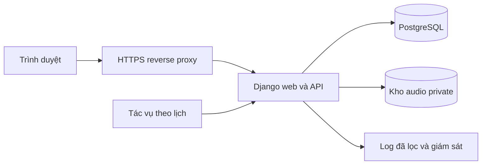

# EDUWEB: đặc tả triển khai

Phiên bản 2.0, ngày 11/11/2026. Thay thế toàn bộ bản 1.0. Đây là phương án mặc định đã chọn theo yêu cầu chủ dự án; agent có thể bắt đầu mà không cần hỏi lại các lựa chọn trong tài liệu. Thay đổi quy tắc phải cập nhật đặc tả và ca nghiệm thu.

Cập nhật ngày 12/11/2026: chế độ luyện tập từng câu, chế độ kiểm tra, ba loại câu tương tác và hỗ trợ bài viết/phát âm được mô tả thêm tại [luyện tập tương tác](docs/luyen-tap-tuong-tac.md). Tài liệu này điều chỉnh phạm vi loại câu và giao diện của phiên bản 2.0; các quy tắc bảo mật và công bố kết quả còn lại tiếp tục áp dụng.

## Phạm vi bàn giao

Website bài tập tiếng Anh cho một giáo viên quản lý nhiều lớp. Học sinh dùng mã cá nhân, làm trắc nghiệm, viết và ghi âm. Giáo viên chấm writing/speaking, công bố kết quả, theo dõi bốn kỹ năng, lỗi từng gặp và tiến bộ. Phân nhóm theo trường, khối, lớp trường và lớp tiếng Anh. Giao diện học sinh vui, dễ dùng trên điện thoại; phần giáo viên gọn và chuyên nghiệp.

V1 phải có quản lý học sinh/lớp, mã và nhớ thiết bị, tạo/nhập đề CSV/XLSX, đủ reading/listening/speaking/writing, giao bài, lưu nháp, chấm tự động và chấm tay theo tiêu chí, công bố riêng kết quả/đáp án, sổ lỗi, báo cáo, xếp hạng theo kỳ, xuất CSV và quy trình sao lưu/khôi phục. Các giai đoạn chỉ chia thứ tự xây, không loại chức năng khỏi V1.

Ngoài V1: học phí, nhân sự, cổng phụ huynh, nhiều trung tâm độc lập, AI chấm bài, lớp trực tuyến, giám sát thi, tự nhận dạng đề Word/PDF, gửi SMS/email. Đây là hệ thống bài tập ở nhà, không phải kỳ thi xác minh danh tính.

## Phương án đã chốt

| Nội dung | Quyết định |
|---|---|
| Quyền | Một OWNER và nhiều STUDENT, không đăng ký công khai. |
| Mã cá nhân | Ngẫu nhiên, dùng lại, cấp riêng; đổi mã thu hồi toàn bộ phiên. Không xác thực bằng IP. |
| Mã lớp/bài | Chỉ định tuyến sau đăng nhập, không cấp quyền hay tự tham gia lớp. |
| Lần làm | Một lần chính thức; giáo viên có thể cấp lần thay thế và giữ nguyên lịch sử. |
| Đề | Phiên bản đã phát hành bất biến. |
| Đánh giá | Tách mức đạt, xu hướng và tiến độ nộp bài. |
| Xếp hạng | Danh sách học sinh và bộ bài chung được cố định theo kỳ. |
| Kỹ thuật | Python 3.13, Django 5.2 bản vá mới nhất tương thích, PostgreSQL 17. Django templates, CSS và JavaScript thuần. |
| Hạ tầng | Một ứng dụng cùng origin cho web/API, kho audio S3 tương thích private. Không cần microservice hay Redis ở V1. |

Mục tiêu kiểm thử: 1.000 hồ sơ học sinh, 100 em làm đồng thời, 30 lớp tiếng Anh hoạt động. Đây là mục tiêu, chưa phải kết quả đo. Hiển thị Asia/Ho_Chi_Minh, lưu thời gian UTC. Giao diện tiếng Việt, đề có thể bằng tiếng Anh.

## Tài liệu chuẩn cho agent

Đọc theo thứ tự. Mỗi tệp chịu trách nhiệm phần được ghi dưới đây. Nếu có mâu thuẫn, sửa tài liệu trước khi triển khai phần đó, không âm thầm chọn một cách hiểu.

| Tệp | Nội dung |
|---|---|
| [01-nghiep-vu.md](docs/01-nghiep-vu.md) | Quyền, mã, bài, chấm, đánh giá và xếp hạng. |
| [02-du-lieu.md](docs/02-du-lieu.md) | Bảng, trường, quan hệ, ràng buộc và giao dịch. |
| [03-api-va-nhap-de.md](docs/03-api-va-nhap-de.md) | API, lỗi, đồng bộ nháp và mẫu nhập. |
| [04-giao-dien.md](docs/04-giao-dien.md) | Màn hình, bố cục và tương tác. |
| [05-trien-khai-va-nghiem-thu.md](docs/05-trien-khai-va-nghiem-thu.md) | Kiến trúc, bảo mật, vận hành, công việc và nghiệm thu. |
| [questions.csv](docs/examples/questions.csv) | Mẫu đề giả lập hợp lệ. |
| [students.csv](docs/examples/students.csv) | Mẫu danh sách học sinh giả lập. |

Agent bắt đầu M0 trong tài liệu 05, tạo ứng dụng tại thư mục gốc hiện tại. Django migrations là nguồn chuẩn database, không duy trì thêm một bộ SQL song song. Khóa phiên bản dependency chính xác. Dùng PostgreSQL để kiểm thử giao dịch, không thay bằng SQLite hoặc mock rồi báo hoàn thành.

Có thể xây và kiểm thử local ngay. Tên miền, tài khoản cloud, vùng dữ liệu, ngân sách và thông báo quyền riêng tư thực tế được chủ dự án chốt trước khi đưa lên mạng. Agent không tự mua dịch vụ hay công khai dữ liệu học sinh.

## Nguồn kỹ thuật

Python/Django đối chiếu [Django 5.2](https://docs.djangoproject.com/en/5.2/releases/5.2/); chọn bản vá đang được hỗ trợ khi cài. Chu kỳ database: [PostgreSQL versioning](https://www.postgresql.org/support/versioning/). Phiên và CSRF: [Django security](https://docs.djangoproject.com/en/5.2/topics/security/) và [OWASP Session Management](https://cheatsheetseries.owasp.org/cheatsheets/Session_Management_Cheat_Sheet.html). MFA: [django-two-factor-auth](https://pypi.org/project/django-two-factor-auth/), không tự viết TOTP. XLSX: openpyxl cùng defusedxml theo [hướng dẫn openpyxl](https://openpyxl.readthedocs.io/en/stable/).
